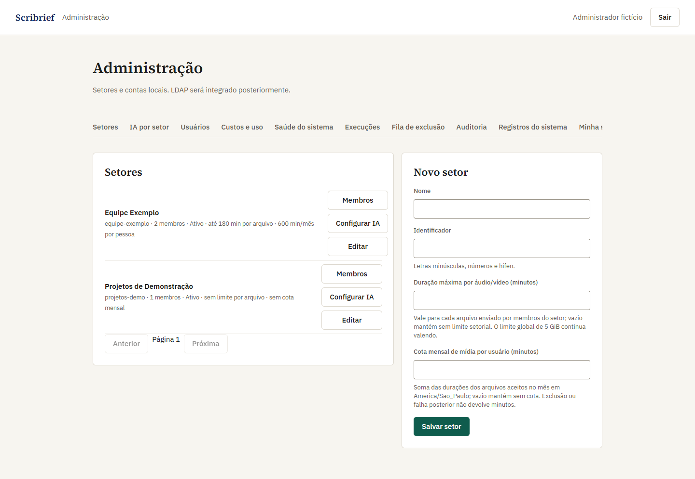
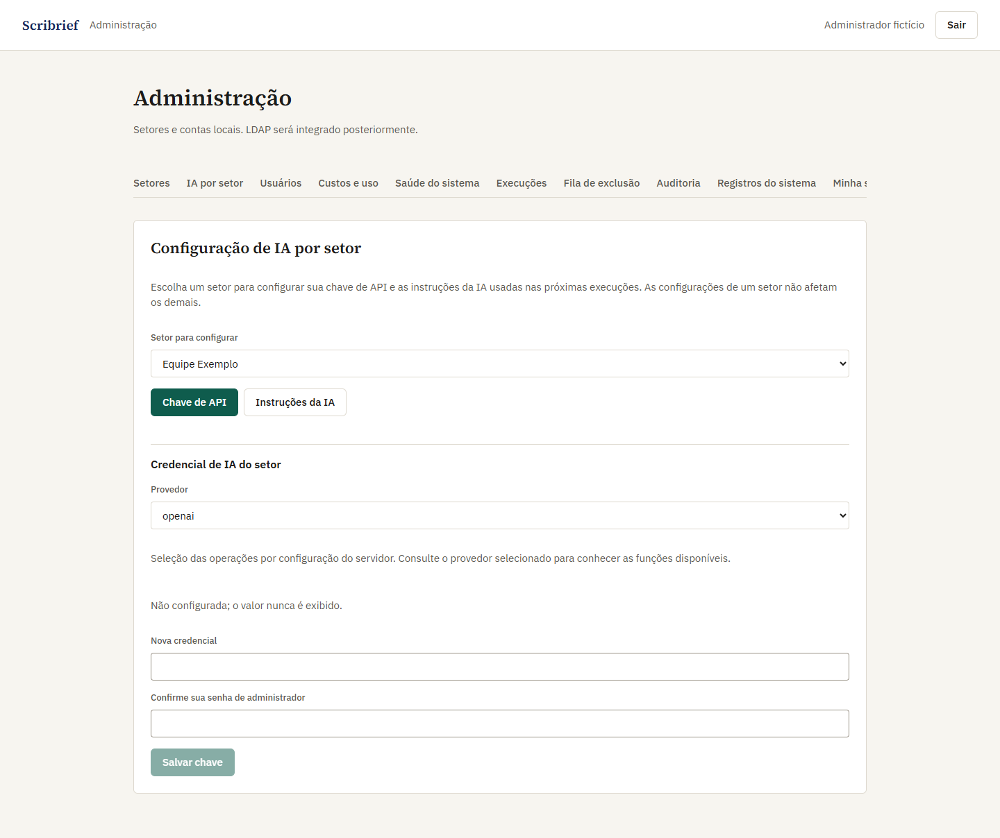
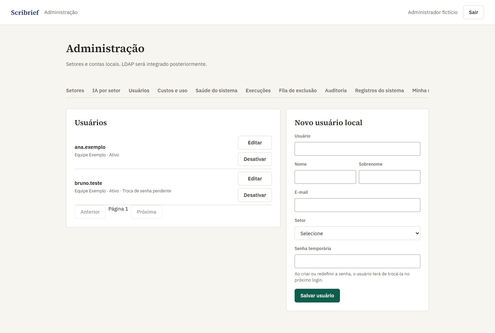

# Scribrief

Scribrief transforma gravações autorizadas de reuniões em **transcrição por falante, ata por tópicos e mapa mental**. O usuário pode revisar falas, editar a ata e compartilhar a leitura com seu setor. A IA pode errar: revise o resultado antes de usá-lo.

> **Beta para rede interna. Não publique a interface na Internet.** O servidor precisa de saída HTTPS para a API da OpenAI, mas **não** de entrada da Internet. Somente a OpenAI funciona como provedor de IA nesta versão.

## Instalação rápida

Requisitos: Docker em execução e Docker Compose. No **Windows 11**, use Docker Desktop com WSL 2 e PowerShell 7; no **Linux**, Docker Engine com Compose plugin. Execute os comandos na máquina que hospedará o Scribrief. Não é necessário instalar Python, Node ou ffmpeg no host.

**Antes de instalar:** descubra o IP/DNS **interno** do servidor (exemplo: `192.168.1.50`). No arquivo `deploy/beta.env`, coloque esse endereço em `PUBLIC_HOSTNAME`, mas **mantenha `PUBLIC_BIND_IP=127.0.0.1` e `ADMIN_BIND_IP=127.0.0.1`**. Assim, o certificado inicial já inclui o endereço da LAN, mas a senha inicial não fica acessível pela rede.

### Windows — PowerShell 7

```powershell
git clone https://github.com/Arthurzineo/Scribrief-OSS.git
cd Scribrief-OSS
Copy-Item deploy/beta.env.example deploy/beta.env
# Edite deploy/beta.env: PUBLIC_HOSTNAME=<IP-ou-DNS-interno>; não altere os BIND_IP ainda.
.\deploy\install.ps1
```

### Linux — Bash

```bash
git clone https://github.com/Arthurzineo/Scribrief-OSS.git
cd Scribrief-OSS
cp deploy/beta.env.example deploy/beta.env
# Edite deploy/beta.env: PUBLIC_HOSTNAME=<IP-ou-DNS-interno>; não altere os BIND_IP ainda.
bash deploy/install.sh
```

O instalador cria os segredos locais e, se você não fornecer certificado, gera um **HTTPS autoassinado válido por 90 dias**. O navegador avisará que ele não é confiável; para uso corporativo, prefira certificado da CA interna. Se você mudar `PUBLIC_HOSTNAME` depois, precisará substituir o certificado por outro que contenha o novo nome/IP no SAN. Consulte [Operação e atualização](UPGRADE.md).

### Primeiro acesso e portas

| Interface | URL padrão | Quem pode acessar |
|---|---|---|
| Administração | `https://127.0.0.1:18575/admin/` | Inicialmente, **somente no próprio servidor**. |
| Usuários | `https://<PUBLIC_HOSTNAME>:18574/login/` | Após liberar o bind público, apenas estações autorizadas da LAN. |

Em **instalação nova**, entre na administração com `ADMIN` / `ADMIN123` e **troque a senha imediatamente**. Até essa troca, as duas portas devem permanecer em `127.0.0.1`; o sistema bloqueia a conta inicial se qualquer bind for aberto à rede. Não é criada conta `demo`. A nova senha precisa ter pelo menos 12 caracteres e ser diferente da atual.

**Depois da troca**, edite `deploy/beta.env`: mude somente `PUBLIC_BIND_IP` para o IP **privado** do servidor, igual à interface de rede que atenderá a LAN (por exemplo, `192.168.1.50`). Mantenha `ADMIN_BIND_IP=127.0.0.1` para administrar no próprio host. Configure o firewall para permitir a porta **18574** apenas às estações autorizadas; **não faça port forwarding/NAT da Internet**. Aplique a configuração:

```powershell
# Windows / PowerShell 7
.\deploy\install.ps1 -SkipAdmin
```

```bash
# Linux / Bash
bash deploy/install.sh --skip-admin
```

Agora os usuários entram em `https://<PUBLIC_HOSTNAME>:18574/login/`. Verifique as portas com `docker compose --env-file deploy/beta.env -f compose.beta.yaml ps`. A porta administrativa **18575** continua local; expô-la a uma rede de gestão exige firewall/ACL e certificado adequado, nunca acesso pela Internet. Porta separada não substitui proteção de rede.

## Configuração inicial no painel

Entre em **Administração** na porta 18575 e siga esta ordem:

1. **Setores → Novo setor:** informe nome e identificador. Cada usuário pertence a um único setor. Opcionalmente, defina duração máxima de cada gravação e cota mensal de minutos por pessoa.
2. **Setores → Configurar IA → Chave de API:** escolha `openai`, cole a chave **daquele setor**, confirme sua senha de administrador e salve. Sem chave do setor, a IA desse setor não processa reuniões; **não há chave geral de fallback**. O valor não é mostrado novamente e fica cifrado no banco. Guarde `deploy/secrets/sector_key` em backup protegido.
3. **IA por setor → Instruções da IA:** se necessário, personalize separadamente os prompts de **ata**, **mapa mental** e **sugestões de correção**; confirme sua senha e salve. A transcrição diarizada não aceita system prompt. Não inclua segredos ou dados pessoais nos prompts.
4. **Usuários → Novo usuário local:** escolha o setor e defina uma senha temporária forte. Entregue-a por canal seguro. O usuário terá de **trocá-la no primeiro login** antes de ver reuniões. Se o administrador redefinir a senha depois, as sessões antigas são revogadas e nova troca é obrigatória. Ainda não há LDAP.
5. Faça uma reunião de teste com mídia **autorizada**, confirme o consentimento após o upload e revise transcrição, ata e mapa antes de usar os resultados.

### Compartilhar ou transferir uma reunião

Por padrão, **só o dono** vê a reunião. Em **Acesso à reunião**, ele pode permitir **leitura** por colegas do mesmo setor; eles poderão consultar áudio, transcrição, ata e mapa, mas não editar/excluir. Para entregar a ata a outra pessoa, use **Transferir toda a reunião para** e selecione um membro ativo **do mesmo setor**. A transferência muda o dono de **todos os artefatos**, não apenas da ata; o novo dono passa a poder editar e excluir. O antigo dono perde essas permissões, salvo leitura setorial se estiver ativada.

## Imagens de exemplo

As capturas abaixo mostram a interface real com **respostas de API simuladas e nomes fictícios**; não usam contas, chaves ou reuniões de uma instalação verdadeira.

<details><summary>Ver telas do painel administrativo</summary>







</details>

## Limites e segurança em resumo

- Upload: `MAX_UPLOAD_MB=5120` por padrão (cerca de **5 GiB**), configurável; esse tamanho máximo **não foi homologado em teste de carga**. Limites opcionais por setor: 1–10.080 min por arquivo e 1–44.640 min/mês por usuário.
- Mídia fica em **arquivos privados**, nunca em BLOB no banco. O original/vídeo é apagado após transcrição bem-sucedida; o áudio MP3 permanece. Excluir oculta a reunião; o admin pode restaurá-la em até **72 horas**, antes da purga. Backups seguem retenção própria.
- Senhas usam hash, sessão HTTPS/CSRF e acesso por proprietário/setor são verificados no backend. Chaves OpenAI são cifradas por setor; logs ativos de ação/sistema são mantidos por **90 dias**. Os custos mostrados são **estimativas parciais**, não a fatura oficial.
- Proteja `deploy/secrets/`, banco, volumes de mídia/TLS e backups. **O script de backup não cifra os arquivos**: use destino cifrado e ACL. Não execute `docker compose down -v`, pois isso remove volumes.
- O beta **não está homologado para produção nem para a Internet**; ainda há riscos de imagem/dependências e testes operacionais pendentes. Faça backup e ensaie a restauração antes de dados reais. Veja [arquitetura e limites](ARCHITECTURE.md), [atualização/backup](UPGRADE.md) e [relato privado de vulnerabilidades](SECURITY.md).

## Licença

Código original sob [AGPL-3.0-only](LICENSE), com uso comercial permitido e obrigações de disponibilização do código-fonte correspondente aos usuários de uma versão modificada oferecida pela rede. Copyright © 2026 Arthur Gonçalves e contribuidores, na extensão dos direitos que detenham. Veja [avisos de terceiros](THIRD_PARTY_NOTICES.md). A publicação aberta permanece condicionada às verificações de segurança e proveniência pendentes.
